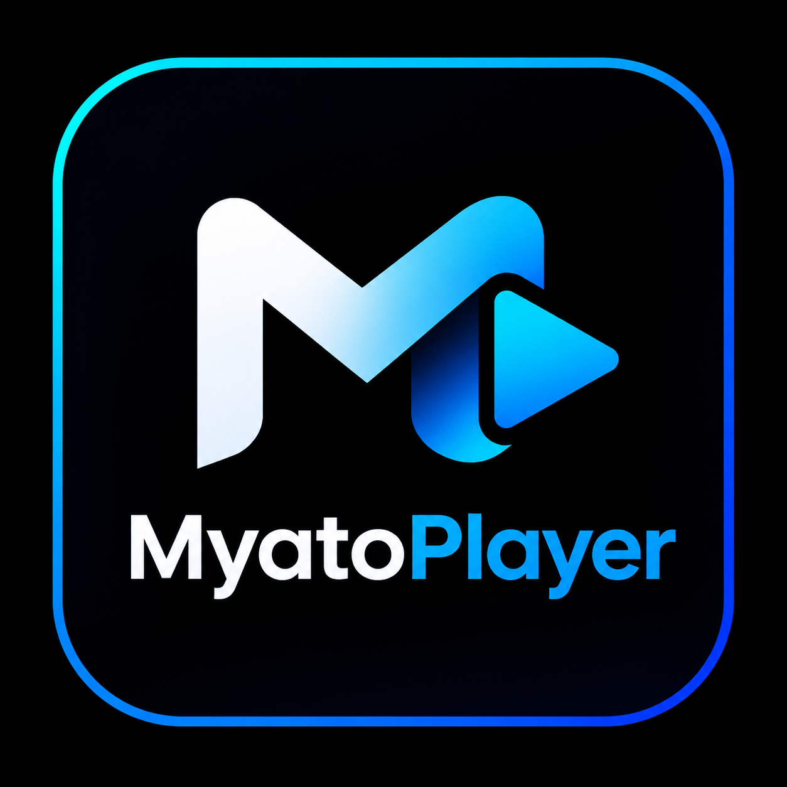

# 🎵 MyatoPlayer — Reprodutor de Música e Downloader Profissional

**MyatoPlayer** é um aplicativo Android completo, moderno e comercial, combinando o design refinado e a experiência de uso de plataformas como Spotify, Apple Music e YouTube Music com um avançado **Centro de Downloads** inspirado no aplicativo Muka e reprodução offline de alta fidelidade sem necessidade de login obrigatório.

---

## 📲 Download do APK

O aplicativo está compilado e pronto para instalação imediata no seu celular Android:

- **Arquivo no projeto:** `./MyatoPlayer.apk` ou `app/build/outputs/apk/debug/app-debug.apk`
- **Tamanho:** ~34 MB
- **Compatibilidade:** Android 7.0 (API 24) até Android 15 (API 36)

Para instalar:
1. Baixe o arquivo `MyatoPlayer.apk`.
2. No seu aparelho Android, toque no arquivo e confirme a instalação (habilite "Permitir desta fonte" caso solicitado).
3. Abra o **MyatoPlayer** e aproveite suas músicas com som equalizado e downloads rápidos!

---

## ✨ Funcionalidades Principais

### 1. 🚀 Identidade Visual Oficial & Splash Screen
- **Logotipo Oficial**: Integrado no ícone adaptativo (`ic_launcher`), na tela de inicialização animada (Splash Screen) e nos cabeçalhos das telas.
- **Paleta de Cores Premium**: Fundo preto profundo (AMOLED), azul elétrico e ciano brilhante, tipografia nítida e gradientes sutis.

### 2. 🧭 Navegação em 5 Abas
1. **Início (Home)**: Card "Continuar Ouvindo", carrosséis horizontais de "Tocadas Recentemente", "Mais Ouvidas", "Músicas Curtidas" e "Álbuns Encontrados".
2. **Biblioteca (Library)**: Gestão de arquivos locais com filtros rápidos ("Todas", "Curtidas", "Álbuns", "Artistas"), seleção múltipla em lote e Pull-to-refresh.
3. **Downloads**: Hub completo com download por link direto de áudio, monitoramento de progresso em tempo real, cálculo de velocidade (KB/s ou MB/s), pausar/retomar/cancelar e importador de arquivos locais.
4. **Playlists**: Criação ilimitada de playlists personalizadas, adição e remoção de faixas, reprodução sequencial e aleatória.
5. **Configurações (Ajustes)**: Temporizador de sono (Sleep Timer), velocidade de reprodução (0.5x a 2.0x), equalizador gráfico, limpador de cache e informações sobre o app.

### 3. 📥 Centro de Downloads (Estilo Muka)
- **Downloader de Links Diretos**: Suporta fluxos e links de áudio da internet (`MP3`, `FLAC`, `WAV`, `AAC`, `M4A`).
- **Gerenciador de Fila**: Exibe porcentagem exata, bytes baixados, tamanho total e velocidade em tempo real.
- **Ações Rápidas**: Pausar, retomar, cancelar e excluir downloads.
- **Adição Automática à Biblioteca**: Músicas baixadas são salvas no armazenamento de música do app e cadastradas no banco de dados Room para tocar offline instantaneamente.
- **Sugestões Rápidas**: Links pré-configurados de trilhas sem direitos autorais para testar o download com 1 toque.

### 4. 🎛️ Equalizador Profissional (AudioFX)
- **5 Bandas Gráficas**: 60Hz, 230Hz, 910Hz, 3.6kHz e 14kHz (-15dB a +15dB).
- **Bass Boost (Graves)**: Ajuste de força de 0% a 100%.
- **Virtualizador**: Efeito surround espacial 3D de 0% a 100%.
- **Presets**: Rock, Pop, Jazz, Clássico, Eletrônica, Hip-Hop, Flat e Personalizado.

### 5. 🎚️ Player Completo & Controles do Sistema
- Mini-player suspenso com linha de progresso animada.
- Player em tela cheia com visualizador de ondas animado.
- Controles na gaveta de notificações do sistema e na tela de bloqueio via **AndroidX Media3 MediaNotificationManager**.
- Reprodução em segundo plano com suporte a fones de ouvido e Bluetooth.

### 6. ⏱️ Temporizador de Sono (Sleep Timer)
- Defina o desligamento automático em 15, 30, 45, 60, 90 minutos ou tempo personalizado.
- Contagem regressiva ao vivo e pausa automática do áudio.

---

## 🛠️ Arquitetura e Tecnologias

- **Linguagem**: Kotlin 100%
- **Interface**: Jetpack Compose com Material Design 3 (M3)
- **Áudio**: AndroidX Media3 (`ExoPlayer` + `MediaSessionService`)
- **Rede e Downloads**: OkHttp com streaming assíncrono e Kotlin Coroutines
- **Banco de Dados**: Android Room Database com SQLite
- **Arquitetura**: MVVM (Model-View-ViewModel) + StateFlow reativo
- **IA**: Google Gemini via Firebase AI Logic (recomendações inteligentes)
- **Armazenamento**: 100% offline-first sem login compulsório
